# 用程式「蓋」一座巴黎聖母院：沒有模型、沒有照片的春分傍晚

2019 年 4 月那場大火之後，我一直想再看一次火災前的巴黎聖母院。這次我和 AI（Claude）合作，用 three.js 從零「蓋」了一座：尖塔還在、國王廊的 28 位國王站成一排、沉思者托著下巴俯瞰巴黎，廣場上有鴿子、遊客和玩耍的孩子，吉普賽少女愛絲梅拉達正在跳舞，敲鐘人加西莫多躲在鐘樓上偷看她，遠處傳來清脆的鐘聲。

整個場景只有一條規則：**不准用任何 3D 模型、貼圖或照片，所有東西都用程式生成。** 每一塊石頭的紋路、每一尊雕像的衣褶、天空、甚至背景音樂，都是在你的瀏覽器裡由程式即時算出來的。

👉 **進入場景：**（在這裡貼上網頁連結；網頁是獨立的靜態網站，可放在 GitHub Pages、Netlify 等任何地方，不需要伺服器）

---

## 成品有什麼

- **一座可以自由飛行的聖母院**：從廣場走到門前看門楣浮雕，飛上國王廊、玫瑰窗，飛到北塔轉角和沉思者面對面，再從塞納河上空看南側的飛扶壁和 96 公尺的尖塔。
- **導覽介紹**：點底部的地點，會跳出那個地方的歷史小故事；右上角「關於聖母院」有完整年表。
- **《鐘樓怪人》的角色**：愛絲梅拉達和她的小山羊佳麗、4 名伴舞、敲鐘人加西莫多、副主教法羅路、騎白馬的侍衛隊長菲比斯和 2 名侍衛，還有遊唱詩人葛林果利。
- **30 個會動的路人和動物**：散步的老人、追逐的孩子、拍照的遊客、長椅上看書的當地人，還有 14 隻鴿子、2 隻貓、2 隻狗。
- **程式合成的聲音**：一首原創的慢板巴薩諾瓦，加上從鐘樓傳來的鐘聲，戴耳機轉頭會聽到方向改變。
- **一支 70 秒的導覽影片**：照固定鏡頭路線逐格算出來。

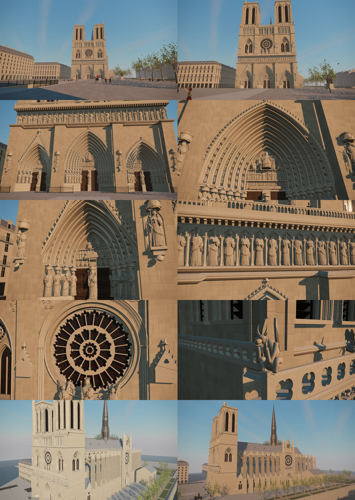

---

## 製作過程

### 1. 先畫平面圖，再動工

我做的第一件事不是畫面，而是一份「平面圖」：一個叫 `layout.js` 的檔案，用公尺記下教堂每個部分的位置和大小。之後所有程式都**只能從這份檔案讀座標**，誰都不准自己寫死數字。

- 全長 128 公尺、西立面寬 41 公尺、鐘樓 69 公尺、尖塔 96 公尺
- 三座門、28 尊國王、玫瑰窗直徑 9.6 公尺、兩面袖廊玫瑰窗 12.9 公尺
- 28 組飛扶壁、60 隻滴水獸、前廣場的鋪面、路燈、樹、塞納河與橋

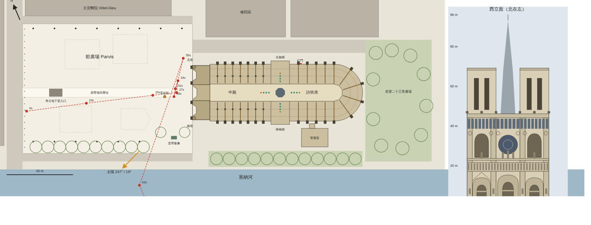

### 2. 選一個「看得見雕刻」的時間

一開始我想要清晨。但聖母院的西立面朝西北西，清晨的太陽一定在東邊，**正面所有雕刻都會在陰影裡**。

最後選了**春分前後的傍晚 17:00**：太陽在西南方、仰角 19 度，從左前方約 46 度斜照立面。光不是正面平照，也不是貼著牆面，門洞裡一整排雕像會一邊亮一邊暗，衣褶的陰影最清楚。樹也跟著季節，是 3 月剛冒新芽的法國梧桐。

**調色也來回改過。** 第一版的畫面偏亮、偏黃白，我懷疑是不是曝光過頭，於是查證了兩件事：用天文公式驗算太陽位置（春分 17:00 確實是 247°、仰角 19°；秋分要到約 17:43 才是同樣的角度），再量畫面的實際像素，結果沒有爆白，只是比真實照片略亮。接著做了「暖金低調」和「半陰天」兩種風格來比較（下圖左到右：原版、暖金、半陰天），最後選了暖金：石頭變成蜂蜜色，亮度降了約 20%，雕刻的立體感幾乎沒有損失。半陰天雖然更像真實的巴黎天氣，但陰影變淡，雕刻會不夠立體。

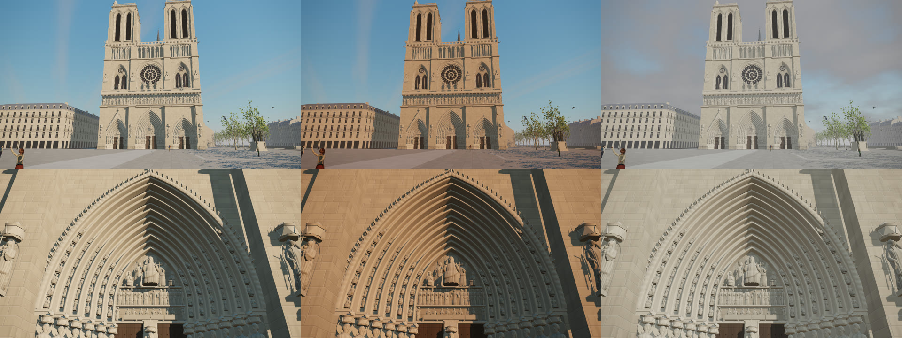

### 3. 用照片校正比例

我提供了十幾張實地照片，AI 拿門側雕像和行人當比例尺，回頭修正平面圖：門比原本估得矮、中央大門比原本估得寬；玫瑰窗改成照片裡「中心小圓 → 12 根細柱 → 24 根細柱」的結構；亞當和夏娃的位置、牆上的三葉形圓章、塔頂的樓梯小塔，也都是看照片才補上的。

### 4. 六個分身平行施工

平面圖定案後，同時開了 6 個 AI 分身，**依工種分工**（不是依位置），每個人只能改自己的檔案：

| 分身 | 負責 |
|---|---|
| 結構 | 牆體、雙塔、飛扶壁、牆上的洞口 |
| 立面與窗 | 門的拱圈、國王廊、玫瑰窗與所有窗花、木門與鐵花 |
| 屋頂與尖頂 | 鉛皮屋頂、尖塔、所有小尖塔 |
| 雕刻 | 人像產生器、門楣浮雕、國王、沉思者、滴水獸、銅像 |
| 廣場與環境 | 鋪面、樹、塞納河、橋、周邊建築 |
| 光影與輸出 | 天空、陰影、霧、鏡頭、影片輸出 |

為了讓六個人做出來的東西接得起來，開工前先準備了幾個共用規則：

- **共用材質**：石灰岩、鉛皮屋頂、彩繪玻璃、青銅……共 29 種，全部用固定的數學雜訊算出紋路，不讀任何圖片。
- **固定種子的隨機數**：每尊國王的長相、每棵樹的枝幹都帶一點隨機，但用固定種子，所以每次打開都長得一模一樣。
- **自動檢查**：每個分身交件前都要通過同一套檢查，包括沒有偷用真隨機、沒有自建材質、同樣輸入建兩次結果完全相同、三角形數不超過預算。

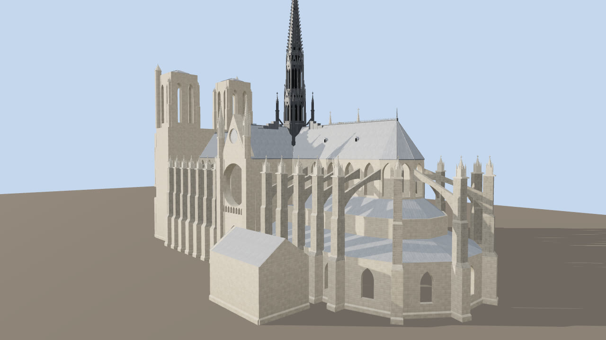

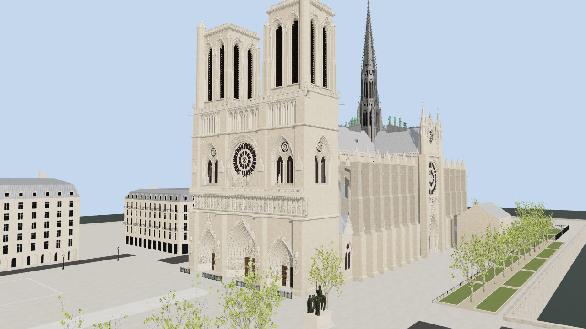

雕刻是我最在意的部分。分身寫了一個「哥德式人像產生器」：用參數組出長袍人物，衣褶是一道道垂直深溝，再加上王冠、主教冠、光環、翅膀，以及書、鑰匙、權杖、天平等二十多種持物。最後審判門的門楣三層浮雕、拱圈上一圈圈的小坐像，都是這樣生出來的。

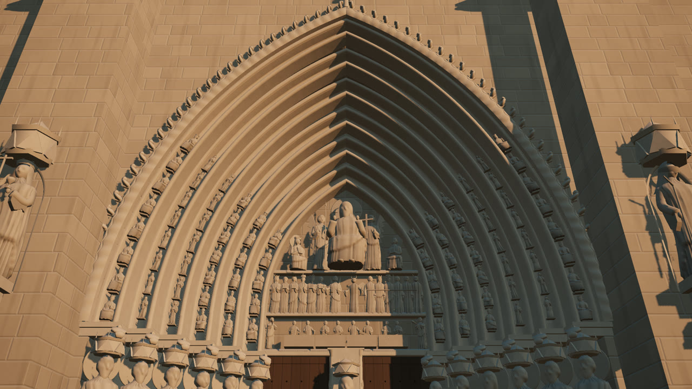

### 5. 整合時抓到的錯

各自做完、放在一起後，才發現一些對不上的地方，例如：

- 最外側的門側雕像有一半嵌在牆裡 → 整排往門洞內側推 0.35 公尺
- 紅門和一扇窗、一座扶壁墩重疊 → 移到開間正中
- 後殿的窗浮在牆外 1 公尺 → 座標算錯了一個 cos 18°
- 我看影片時發現**鐘樓外側多了兩根很長的柱子** → 原來樓梯小塔被設成從 46 公尺一路升到 73 公尺，照片裡它其實只在塔頂冒出一小截

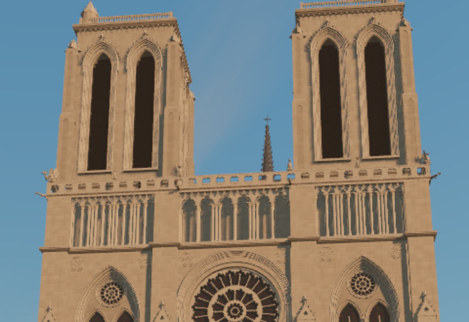

### 6. 算影片：沒有顯示卡的七個小時

雲端機器沒有 GPU，只能用軟體算圖，720p 每格約 12 秒，70 秒（2100 格）要算 7 小時左右。中途因為修鐘樓整支重算過一次，也遇過舊的算圖程序沒停乾淨、偷偷算出 700 多格舊畫面的狀況。最後抽查全片，才確認每一格都是修正後的鐘樓。

### 7. 變成可以走進去的網頁

影片看完，我想自己走進去。因為整個場景本來就是在瀏覽器裡即時生成的，所以把固定鏡頭換成玩家操控就可以了。

操作方式改過一次：一開始是「點畫面鎖定滑鼠」的遊戲式操作，但游標會消失，視角方向也跟直覺相反。後來改成**按住滑鼠拖曳畫面**（像看街景），鍵盤 W/S、A/D、E/Q 分別控制前後、左右、上下，全程自由飛行。

### 8. 30 個會動的人和動物

人物和動物也是用膠囊、球、圓柱拼成的關節骨架，動作只由時間決定。孩子繞圈追逐，一隻小狗跟著跑；另一個小孩每 20 秒衝進鴿群，鴿子整群飛起來繞一圈再落回原地。

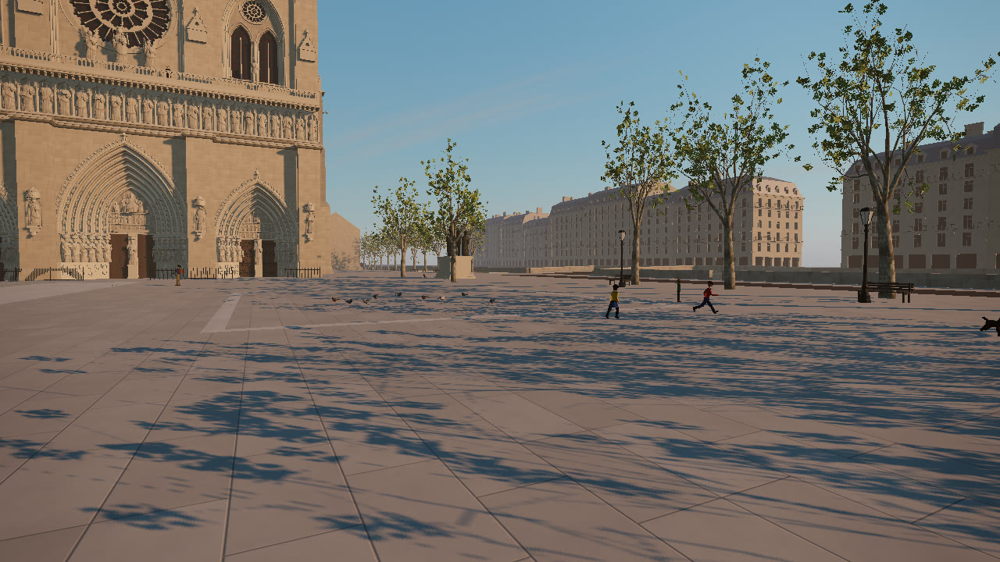

### 9. 走進雨果的小說：《鐘樓怪人》的角色

雨果 1831 年的小說《巴黎聖母院》，台灣常譯作《鐘樓怪人》，故事設定在 1482 年，舞台就是這座教堂和它前面的廣場。既然場景都蓋好了，我就把小說裡的角色也請進來，並且替每個人安排一個符合劇情的位置：

| 角色 | 在哪裡 | 在做什麼 |
|---|---|---|
| 愛絲梅拉達 | 廣場中央 | 紅色長裙、金色腰帶，拿著鈴鼓跳舞，每 8 拍旋轉一圈，舞步節拍跟背景音樂一樣 |
| 4 名伴舞 | 圍繞在她身邊 | 穿顏色較低調的裙子，繞著她轉圈、拍手 |
| 小山羊佳麗 | 她的腳邊 | 繞著她蹦跳，她旋轉時佳麗會用後腳站起來 |
| 加西莫多 | 北塔「怪獸迴廊」欄杆後，和沉思者同一層 | 駝背、紅髮，趴在欄杆上偷看，每隔一陣子就縮回去躲一下 |
| 法羅路 | 玫瑰窗前的「聖母露臺」 | 黑袍、紫色腰帶，俯視著她，時而緊抓欄杆，時而手按胸口別過頭 |
| 菲比斯 | 廣場上巡邏 | 騎著白馬，臉一直轉向跳舞的愛絲梅拉達 |
| 2 名侍衛 | 跟在馬後 | 步行、手持長戟 |
| 葛林果利 | 舞圈旁 | 戴羽毛帽，抱著魯特琴邊走邊彈唱 |

加西莫多和法羅路刻意放在不同的地方：一個在高處的鐘樓躲著，一個站在教堂正面的陽台上，兩個人用各自的方式凝視同一個人。

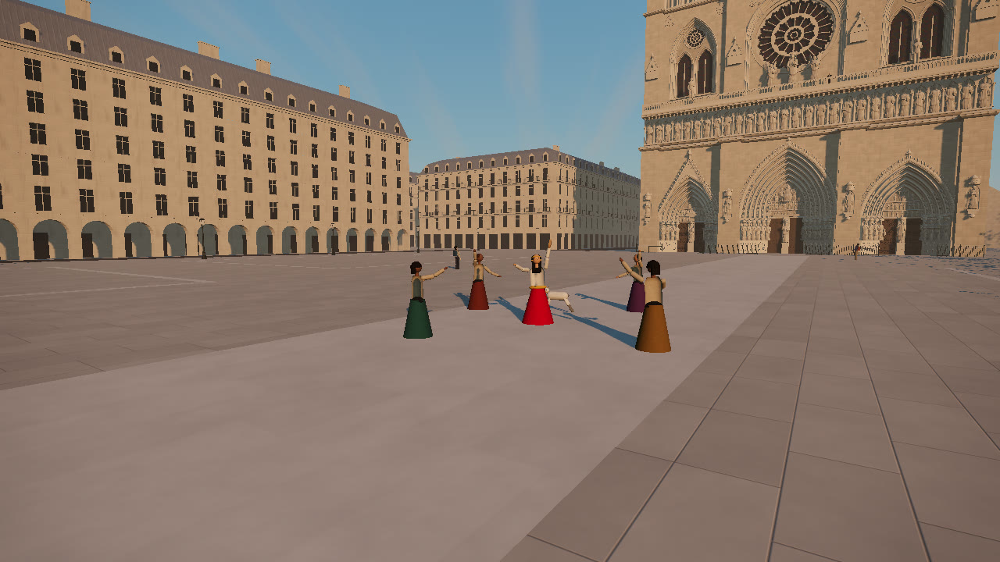

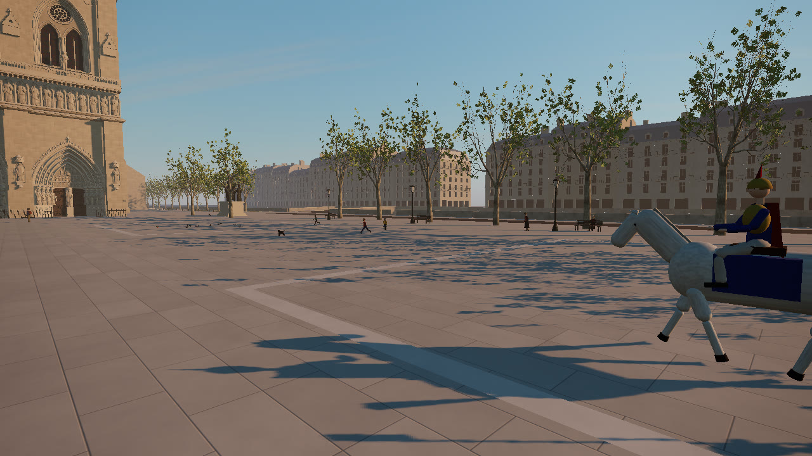

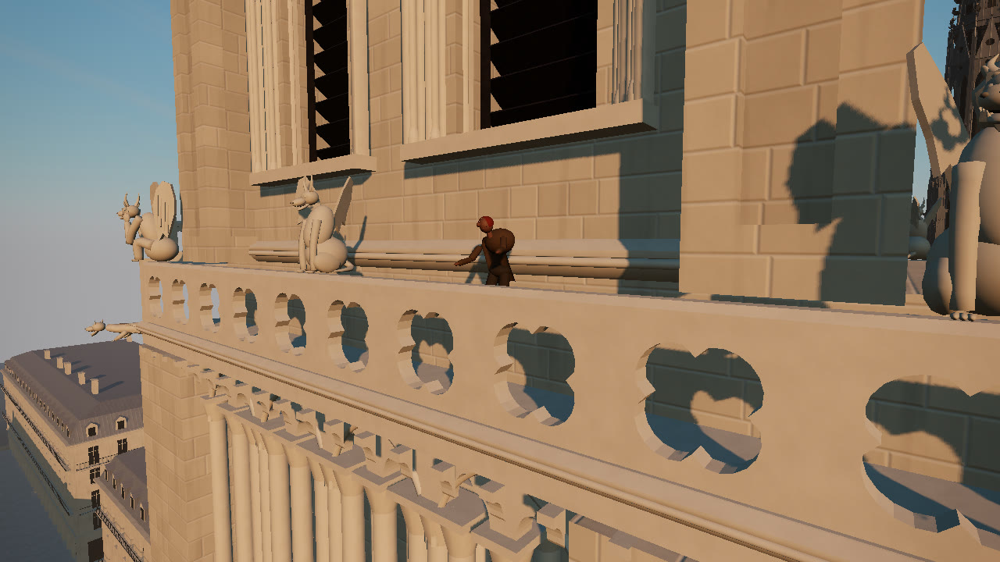

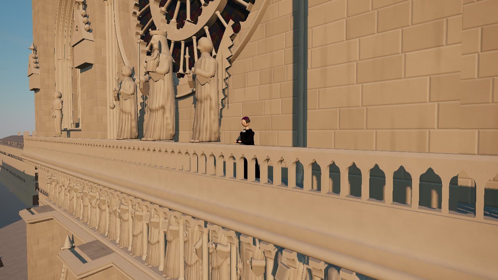

白馬是重做過一次的：第一版身體太短、腿又細又長，看起來不太像馬，改成接近真馬的比例才順眼。

### 10. 聲音：改了最多次的部分

聲音同樣不用任何錄音檔，全部用瀏覽器的 Web Audio 即時合成：

- **鐘聲**：用多個泛音疊出鐘的音色，從兩座鐘樓的位置發出，靠近、轉頭都聽得出方向與遠近。
- **配樂**：第一版是快節奏的手風琴圓舞曲，我覺得太快。改成小野麗莎那種慢板巴薩諾瓦，包括用撥弦演算法合成的尼龍弦吉他、低音提琴、輕刷鼓，旋律用無歌詞的輕柔哼唱聲，曲子是原創的。
- **調整的過程**：
  - 鐘聲和音樂同時開始，聽起來「像在亂彈」→ 鐘聲改成對齊音樂的拍子，在第 10 秒疊進來。
  - 鐘聲小聲時被旋律蓋掉 → 調回原本的音量，但不壓低主旋律。
  - 轉視角時音樂會卡 → 改成一開聲音就先把音樂算成音檔，交給瀏覽器專門播聲音的執行緒播放，畫面再忙也不會中斷。

---

## 網頁操作方式

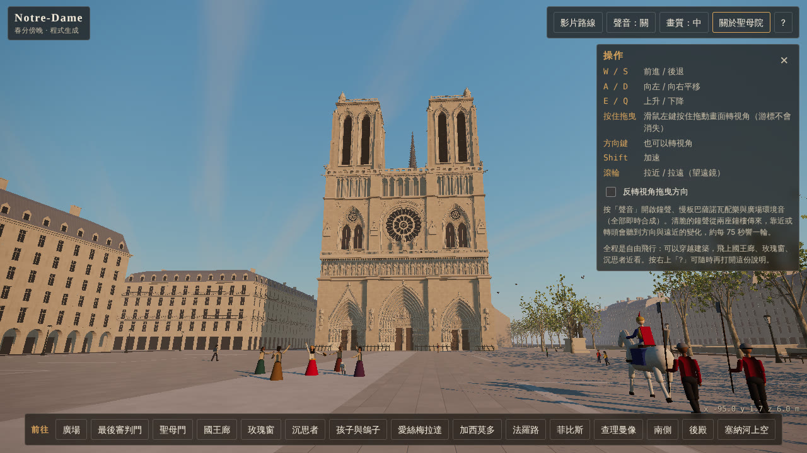

**電腦**

| 操作 | 動作 |
|---|---|
| W / S | 前進 / 後退 |
| A / D | 向左 / 向右平移 |
| E / Q | 上升 / 下降 |
| 按住滑鼠左鍵拖曳 | 轉視角（方向鍵也可以） |
| Shift | 加速 |
| 滾輪 | 拉近 / 拉遠（像望遠鏡） |

**手機、平板**：左下拖曳移動，右邊拖曳轉視角，▲▼ 按鈕升降。操作說明可以按右上角的 × 關掉，或直接碰一下畫面。

**其他功能**

- **前往**（畫面底部）：一鍵跳到廣場、最後審判門、聖母門、國王廊、玫瑰窗、沉思者、孩子與鴿子、愛絲梅拉達、加西莫多、法羅路、菲比斯、查理曼像、南側、後殿、塞納河上空，並顯示那裡的歷史或小說背景介紹。
- **關於聖母院**：簡介與 1163 年到 2024 年重新開放的年表。
- **影片路線**：照影片的 70 秒鏡頭自動飛一遍，隨時可以停下來接手。
- **聲音**：開啟鐘聲、配樂與廣場環境音（瀏覽器規定要按一下才能出聲）。開啟後可以再單獨關掉音樂。
- **畫質**：畫面卡的話切到「低」。
- **?**：隨時打開操作說明。

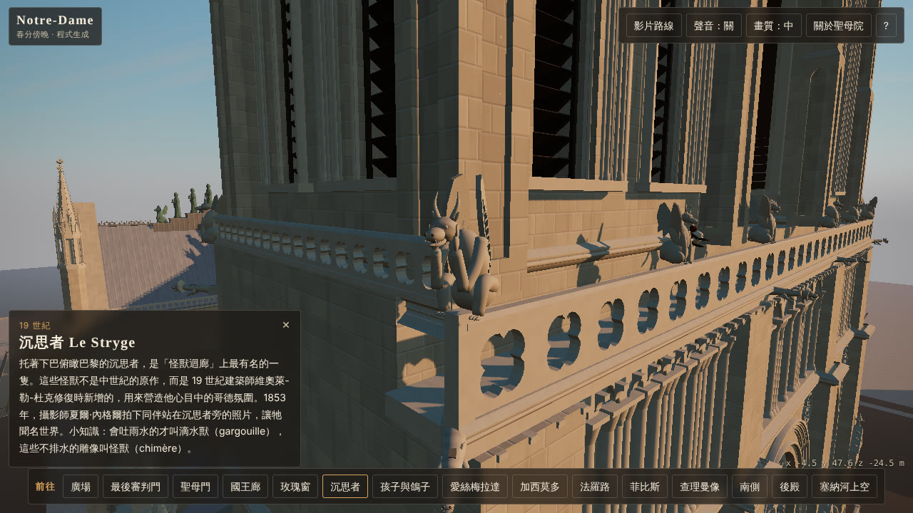

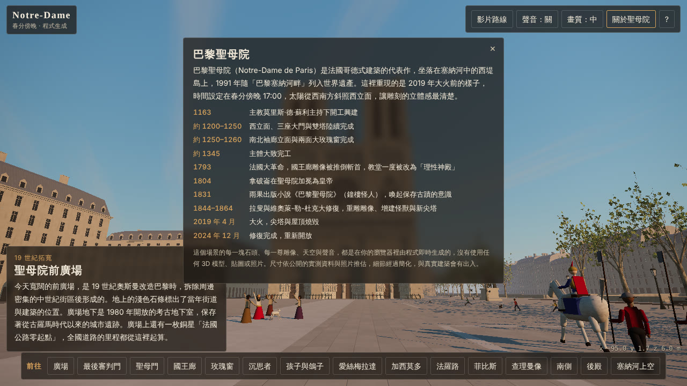

**小提醒**：第一次打開要在瀏覽器裡現場生成整座教堂，電腦大約 20–60 秒，建議用電腦觀看；手機可以開，但比較吃力。

---

## 一些數字

- 約 **410 萬**個三角形：結構 2.3 萬、立面與窗 118 萬、屋頂與尖塔 19 萬、雕刻 198 萬、廣場與環境 63 萬、人物與動物 9.8 萬
- **29** 種程式生成的材質
- **43** 個會動的人和動物：30 個路人與動物，加上 11 個小說角色、1 匹白馬和小山羊佳麗
- **70** 秒影片、2100 格，720p 每格約 12 秒
- **0** 個 3D 模型、貼圖、照片或錄音檔

## 跟真實聖母院的差距

- 尺寸依公開資料與照片推估，細節經過簡化，與真實建築會有出入。
- 人物和雕像的臉偏抽象，近看會像面具；小說角色是依小說描述和常見印象設計的造型，不是任何電影或動畫版本。
- 影片是加入人物與小說角色之前算的，角色目前只在互動網頁裡看得到。
- 教堂內部沒有做，大門是關著的。
- 這是「2019 年大火前」的樣子。2024 年 12 月修復完成的聖母院，尖塔已依原樣重建。

---

這次最大的收穫是：真正耗時的不是寫程式，而是**「看」**。看照片、看截圖，一次次說出「這裡太長了」「這裡聽起來像亂彈」，再一點一點改到對。希望你也能在這座用程式蓋出來的聖母院裡，找到自己喜歡的角落。
